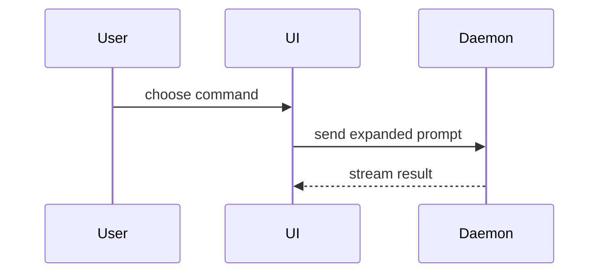

## In this repository

- **Title** is a Conventional Commit with a project scope where one applies
  (`feat(bellypao): ...`, `fix(sun-ui): ...`); release-please reads the history,
  so never mention a version or a changelog entry.
- **Body** fills Summary, Verification and, when relevant, Screenshots in
  `.github/pull_request_template.md`; that file owns the format. Link a related
  issue with `Closes #<issue>` when appropriate.
- **Verification** lists actual commands and their outcomes, including a
  failing-before/passing-after regression test when available. State checks
  not run rather than inventing evidence.
- **Screenshots** show visible changes at relevant viewport sizes.
- **Risk** belongs in Summary: name destructive changes, public API contracts
  and other hard-to-reverse decisions, including their blast radius.

## Sections

Skip preambles and keep prose brief. Use the vocabulary of `CONTEXT.md`.

### Summary

Pick the smallest view that makes the key point clear.

- Show logic or an algorithm as pseudocode:

```text
on(save)
  if content is unchanged
    return cached result
  write new content
  return fresh result
```

- Show runtime control flow as a call tree:

```text
submitForm
  createSession
    persistPrompt
    launchAgent
  navigateToSession
```

- Show UI structure as a component tree, including state and module boundaries that matter:

```text
<SessionPage>                 apps/example/src/routes/session.tsx
  useSessionEvents()
  <SessionToolbar>
    <RunSkillButton>          packages/ui
```

- Show file responsibility or a broad refactor as a shallow file tree:

```text
src/
|- commands/
|- sessions/
+- transport/
```

- Show component interaction, control flow, or data flow with Mermaid:



- Use `diff` when the point is what changes and the surrounding shape already exists. Match the diff shape to the topic.

For a component change:

```diff
 <SessionPage>
   useSessionEvents()
   <SessionToolbar>
+    <RunSkillButton />
   <SessionTimeline>
+    <SkillResultCard />
```

For a file-layout change:

```diff
 src/
   commands/
+    show-me.ts
   sessions/
-  transport.ts
+  transport/
+    client.ts
+    stream.ts
```

For a call-tree or call-stack change:

```diff
 submitForm
   createSession
     persistPrompt
+    expandSkillMention
     launchAgent
-  navigateToSession
+  navigateToSession
+    subscribeToEvents
```

For a state or control-flow change:

```diff
 on(save)
-  write content
+  if content is unchanged
+    return cached result
+  write new content
+  invalidate cache
```

- Show the whole block when most of it is new, when omitted context would hide ownership or order, or when the user needs a copyable target shape:

```ts
function expandSkill(command: string): string {
  const skillName = command.slice(1);
  return `use the ${skillName} skill`;
}
```

#### Guidance

Place each visual next to the short text it supports. Keep only the calls, files, props, states, and boundaries needed to answer the user's current question or the options to resolve the current discussion point.

You may use one of these, you may use several, it is unlikely you will use all of them. Use your judgement and don't overwhelm the user.

### Verification

Concrete evidence that the change works. Show before and after test output
when available, with the command and real outcome. State what was not checked
and why. Never present pseudocode or a suggested command as executed proof.

### Screenshots

For visual changes, include desktop/mobile screenshots near a short explanation
of the visible behavior. Omit this section when there is no visual change.

Describe risk in Summary rather than adding a competing template section.
One-way doors include destructive actions and hard-to-reverse decisions;
two-way doors are cheap to roll back. Name the affected consumers, layouts,
mobile behavior or public contracts without overstating the evidence.
