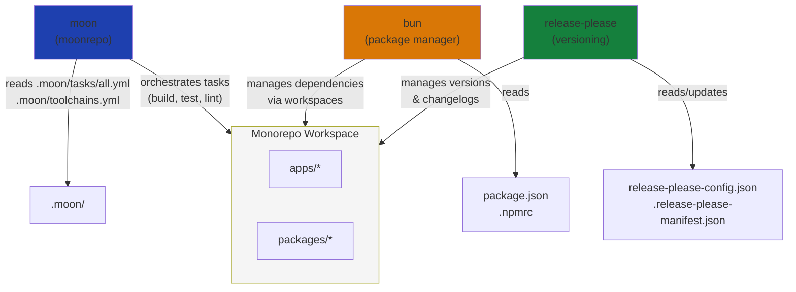

# websites

A moonrepo-based TypeScript monorepo managed with bun.

## Setup

This project uses moonrepo to manage multiple packages and proto to manage tool versions.

For MCP setup, see: https://moonrepo.dev/docs/guides/mcp#setup

### Architecture Overview



> [!NOTE]
> We avoid using scripts in package.json as much as possible, delegating tasks to moonrepo instead. Except for workspace-wide commands in the root project. This enforces the devs to rely on moonrepo for task orchestration and learn its capabilities.

## Prerequisites

### AWS

Make sure you have the AWS CLI installed and configured with the necessary credentials. We recommend using the tool: [granted](https://github.com/fwdcloudsec/granted)

## Common commands

- `bun moon sync projects` or `bun sync` - Sync all project dependencies and configurations. Specially typescript references.

## Package Management

### Adding Dependencies to Workspaces

To add dependencies to a workspace project (apps/_ or packages/_), use the `--cwd` flag with catalog references:

```sh
bun add typescript@catalog:typescript --cwd packages/your-package
bun add -d vitest@catalog:testing --cwd apps/your-app
```

This references versions defined in the root `package.json` catalogs, ensuring consistency across the monorepo.

### Managing the Root Catalog

The root `package.json` defines version catalogs organized by category (tools, testing, typescript, node, styles, types, vite). To add a new dependency to the catalog:

1. Add it to the appropriate catalog in `package.json`:

```json
{
  "workspaces": {
    "catalogs": {
      "tools": {
        "new-tool": "^1.0.0"
      }
    }
  }
}
```

2. Reference it in workspace projects using `catalog:category` syntax

**Remarks:**

- Catalog versions are centrally managed - updating the root catalog updates all references
- Use catalogs for shared dependencies across multiple projects
- Use direct versions (e.g., `bun add package@^1.0.0`) for project-specific dependencies
- The root `package.json` should only contain devDependencies needed for workspace-wide tooling

## How to Add New Packages

### Configure releases

Our releases/changelogs are managed via release-please. To add a new package to the release process, follow these steps:

1. Update `release-please-config.json`

Add the new package path to the packages section:

```json
{
  "packages": {
    ".": {}, // your root package
    "packages/new-package": {
      "release-type": "node" // or whatever type
    }
  }
}
```

2. Update `.release-please-manifest.json`

Add an entry for the new package with its current version github:

```json
{
  ".": "1.0.0",
  "packages/new-package": "0.1.0"
}
```

This change should be made directly on the default branch or on a separate user-created branch/PR which is then merged into the default branch.

For extra information, check the official documentation:

- https://github.com/googleapis/release-please
- https://github.com/googleapis/release-please-action

### Publishing Packages

Publishing happens automatically after release-please creates a release and tags it. The process:

1. Release-please creates a PR with version bumps and changelog updates
2. When merged to main, the release workflow runs
3. If a release is created, the workflow executes `scripts/release.ts`
4. The release script runs `moon run :publish --query "projectSource~packages/*"` to publish all packages

The publish task must be defined in your package's `moon.yml` file. Example:

```yaml
tasks:
  publish:
    command: "bun publish --access public --no-git-checks"
    options:
      runInCI: true
```

### Stuck Tags

See: `.docs/unstuck-tags.md`

## Add new workflow actions

If you want to add new workflows, but do not want them to run on release-please PRs, you can use the following condition in your workflow file:

```yaml
jobs:
  your-job:
    runs-on: ubuntu-latest
    # Skip if PR has any autorelease label
    if: |
      !contains(github.event.pull_request.labels.*.name, 'autorelease: pending') &&
      !contains(github.event.pull_request.labels.*.name, 'autorelease: tagged')
```

And for push ignores, you can use:

```yaml
jobs:
  your-job:
    runs-on: ubuntu-latest
    # Skip if commit message indicates a release-please release
    if: |
      !startsWith(github.event.head_commit.message, 'chore: release') &&
      !startsWith(github.event.head_commit.message, 'chore(main): release') &&
      !contains(github.event.head_commit.message, 'release-please')
```

## Available packages

The monorepo comes the following general packages out of the box:

- `consola` - A fancy console logger for Node.js and browsers. Specially good for CLI applications, scripts and local development.
- `type-fest` - A collection of essential TypeScript types for enhanced type safety and developer experience.
- `execa` - A modern alternative to Node.js's child_process methods, providing a better interface for executing shell commands.
- `destr` - A utility for safely parsing JSON and other data formats, with support for various input types and error handling.
- `yargs` - A powerful command-line argument parser for Node.js, enabling easy creation of interactive CLI applications.
