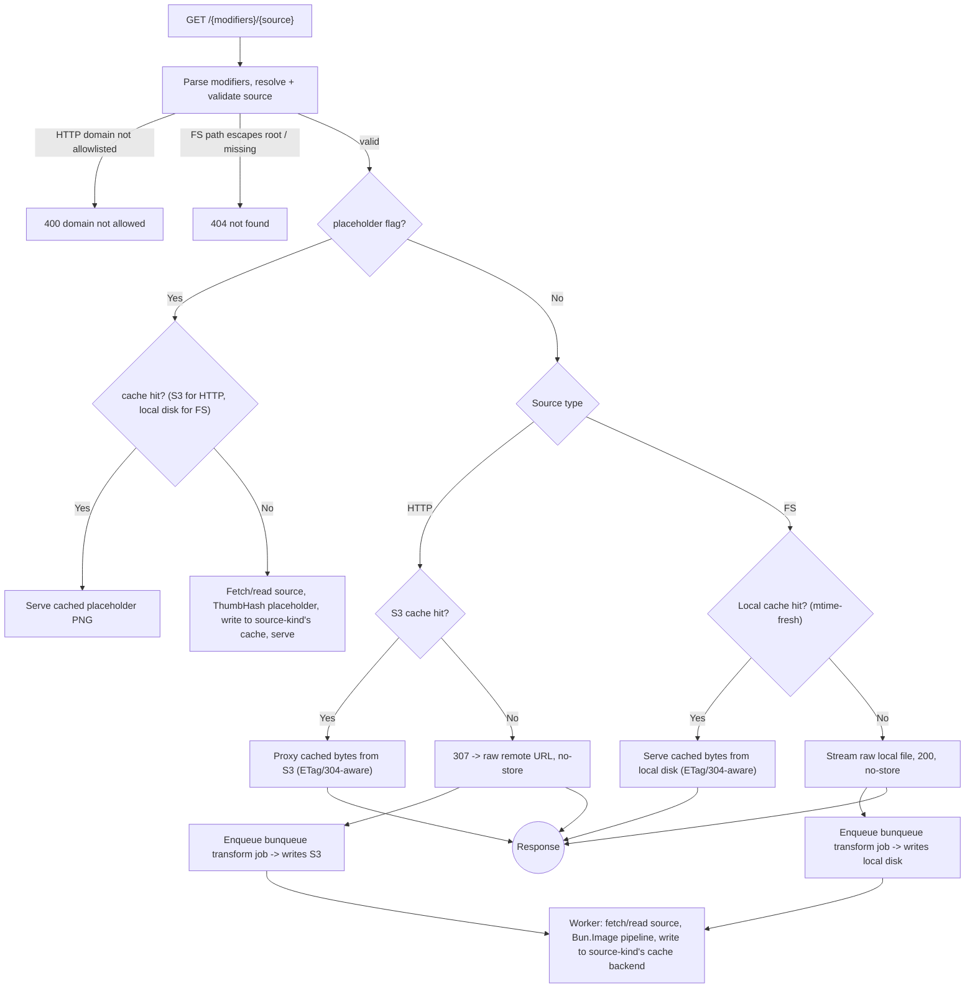

# @vandal-websites/images-app

RIAPI-flavored image transformation and optimization service, built on [`Bun.Image`](https://bun.com/docs/runtime/image), [`Bun.S3Client`](https://bun.com/docs/runtime/s3), and a narrow [`sharp`](https://sharp.pixelplumbing.com/) fallback only for animated GIF output. Migrated from [`ipx-server`](https://github.com/andrevandal/ipx-server).

## How it works

Requests arrive as `/{modifiers}/{source}`. The server parses the modifiers (resize, format, quality, etc.), resolves the source (an allowlisted remote URL or a file under `FS_DIR`), and returns the transformed result.

Both source types follow the same shape — **serve something immediately, transform in the background**:

- **HTTP sources** — a cache miss redirects the client to the raw source immediately (`307`, zero latency, we never touch the bytes) while the transform runs in the background and is written to **S3**.
- **Filesystem sources** — a cache miss streams the _raw, untransformed_ file immediately (`200` — we already hold the bytes locally, so there's no reason to redirect) while the transform runs in the background and is written to a **local disk cache**.

This is a deliberate behavior change from `ipx-server`: filesystem sources there ran synchronously (block, transform, stream). Here, both source kinds go through the same non-blocking background-transform path, mediated by an embedded [`bunqueue`](https://bunqueue.dev) queue+worker.

Standard HTTP caching semantics apply throughout: `ETag`, `Last-Modified`, `Cache-Control`, and `304 Not Modified` are all supported on every cache-hit path.



### Concurrency control

`bunqueue`'s embedded `Worker` runs at most `MAX_CONCURRENT` transforms at a time. Identical concurrent requests for the same source+modifiers are deduplicated via `bunqueue`'s own `jobId` option (the job id is the cache key) — a burst of requests enqueues one job, not N.

### Errors

If a source domain isn't in the HTTP allowlist, or a filesystem source path doesn't resolve to a real file under `FS_DIR`, the server returns a `4xx` directly — there is no raw-source fallback for invalid requests, only for valid sources whose transform is still pending.

## Configuration

Copy `.env.example` and fill in the values:

```sh
cp .env.example .env
```

| Variable               | Default                    | Description                                                                                                                                                                                                                                                                          |
| ---------------------- | -------------------------- | ------------------------------------------------------------------------------------------------------------------------------------------------------------------------------------------------------------------------------------------------------------------------------------ |
| `HTTP_DOMAINS`         | —                          | Comma-separated allowlist of source HTTP domains (exact hostname match, case-insensitive)                                                                                                                                                                                            |
| `HTTP_MAX_AGE`         | `0`                        | Cache-Control max-age (seconds) for HTTP-sourced responses                                                                                                                                                                                                                           |
| `FS_DIR`               | `./assets/images`          | Root directory for filesystem sources                                                                                                                                                                                                                                                |
| `FS_MAX_AGE`           | `0`                        | Cache-Control max-age (seconds) for FS-sourced responses                                                                                                                                                                                                                             |
| `LOCAL_CACHE_DIR`      | `./.data/cache`            | Local disk cache root for FS-sourced transforms + placeholders                                                                                                                                                                                                                       |
| `MAX_CONCURRENT`       | `3`                        | Max simultaneous image transforms (`bunqueue` worker concurrency)                                                                                                                                                                                                                    |
| `S3_ENDPOINT`          | `https://s3.amazonaws.com` | S3-compatible endpoint                                                                                                                                                                                                                                                               |
| `S3_PORT`              | `9000`                     | S3 port                                                                                                                                                                                                                                                                              |
| `S3_USE_SSL`           | `true`                     | Use TLS for the S3 connection                                                                                                                                                                                                                                                        |
| `S3_ACCESS_KEY`        | —                          | S3 access key                                                                                                                                                                                                                                                                        |
| `S3_SECRET_KEY`        | —                          | S3 secret key                                                                                                                                                                                                                                                                        |
| `S3_BUCKET`            | —                          | S3 bucket name — if unset, the durable S3 cache is disabled (every request redirect-passthroughs on a cold hot-cache), but the in-memory/SQLite hot-cache layer (`KV_PATH`) still gets populated by background transforms, so warm requests still serve transformed bytes without S3 |
| `CONSOLA_LEVEL`        | `3`                        | Log verbosity (`0`=silent, `3`=info/warn/error, `4`=debug, `5`=trace) — applied globally via `consola.level` at startup                                                                                                                                                              |
| `AVIF_ENABLED`         | `true`                     | Attempt AVIF encode before falling back to WebP — see [AVIF support](#avif-support) below                                                                                                                                                                                            |
| `KV_PATH`              | `./.data/kv.db`            | SQLite KV store path — backs the hot cache layer, ban list, and rate limiter (see [Bot defense](#bot-defense) below)                                                                                                                                                                 |
| `KV_MAX_BYTES`         | `52428800` (50MB)          | Byte budget for the KV store — oldest-used entries are evicted once exceeded, regardless of value type                                                                                                                                                                               |
| `BAN_STRIKE_THRESHOLD` | `5`                        | Blocklisted-path hits from one client within the strike window before that client is banned                                                                                                                                                                                          |
| `BAN_STRIKE_WINDOW_MS` | `3600000` (1h)             | Rolling window for counting strikes toward a ban                                                                                                                                                                                                                                     |
| `BAN_DURATION_MS`      | `86400000` (24h)           | How long a ban stays active once triggered                                                                                                                                                                                                                                           |
| `RATE_LIMIT_WINDOW_MS` | `300000` (5m)              | Rate limiter window per client                                                                                                                                                                                                                                                       |
| `RATE_LIMIT_MAX`       | `300`                      | Max requests per client per rate-limit window before `429`                                                                                                                                                                                                                           |
| `TRUST_CLOUDFLARE_IPS` | `true`                     | Trust `CF-Connecting-IP` only when the raw TCP peer is a real Cloudflare edge IP — see [Bot defense](#bot-defense) below                                                                                                                                                             |
| `TRUSTED_PROXY_CIDRS`  | _(empty)_                  | Comma-separated CIDRs of reverse proxies whose `X-Forwarded-For` is trusted to identify the visitor (needed behind Traefik/Coolify so a scanner does not get the proxy banned) - see [Bot defense](#bot-defense) below                                                               |

## Running

```sh
# Development (hot reload)
moon run images:dev

# Production build
moon run images:build
bun dist/index.js

# Or, from within apps/images directly
bun --hot src/index.ts
```

## URL format

```
/{modifiers}/{source}

# Resize to 800×600, convert to webp
/w_800,h_600,f_webp/https://example.com/image.jpg

# Auto-format based on Accept header, no other transforms
/f_auto/https://example.com/image.png

# Filesystem source
/w_400/hero.jpg

# Low-quality placeholder for a source (ignores all other modifiers)
/_/hero.jpg?placeholder
```

Modifier separators: `,` `&`
Key/value separators: `:` `=` `_`
Use `_` as the modifiers segment to pass through with no transforms.

Modifier names follow the [RIAPI](https://github.com/riapi/riapi) vocabulary (`width`/`height`/`mode`/`scale`/`format`/`quality`/`rotate`/`flip`) with the same short-form aliases `ipx-server` used (`w`/`h`/`f`/`q`). Per RIAPI's own tie-break rule, if both the long and short form are given, the long form wins. Parsing is case-insensitive; an unrecognized key or an unparseable value is silently dropped rather than causing an error, per [RIAPI's parsing rules](https://github.com/riapi/riapi/blob/master/parsing.md).

### Modifiers reference

Scoped to exactly what `Bun.Image` can execute, with one exception for animated GIF sources - see [Animated GIF support](#animated-gif-support), [RIAPI coverage](#riapi-coverage), and [Dropped modifiers](#dropped-modifiers-no-bunimage-equivalent) for what's real vs. degraded.

| Modifier      | Alias | Values                                                                  | Notes                                                                                                                              |
| ------------- | ----- | ----------------------------------------------------------------------- | ---------------------------------------------------------------------------------------------------------------------------------- |
| `width`       | `w`   | positive integer                                                        |                                                                                                                                    |
| `height`      | `h`   | positive integer                                                        | Height-only requests compute the aspect-correct width via a metadata read first                                                    |
| `mode`        | —     | `stretch`\|`max`\|`pad`\|`crop`                                         | `stretch` maps to `Bun.Image`'s `fit:"fill"`. `max`/`pad`/`crop` all map to `fit:"inside"` — see [RIAPI coverage](#riapi-coverage) |
| `scale`       | —     | `down`\|`both`\|`canvas`                                                | `down`/`canvas` never upscale; `both` allows upscaling                                                                             |
| `format`      | `f`   | `jpeg`\|`png`\|`webp`\|`avif`\|`gif`\|`auto`                            | `auto` negotiates against the `Accept` header. Animated GIF sources only resolve to `webp` or `gif`                                |
| `quality`     | `q`   | `1`-`100`                                                               | jpeg/webp/avif only for `Bun.Image`; animated WebP also uses this value. Use `compression` for png                                 |
| `rotate`      | —     | multiple of 90 in `[-270, 270]`                                         |                                                                                                                                    |
| `flip`        | —     | `none`\|`x`\|`y`\|`xy`                                                  | `x` mirrors vertically, `y` mirrors horizontally                                                                                   |
| `brightness`  | `br`  | number, `1` = unchanged                                                 | not in RIAPI — exposes `Bun.Image`'s `modulate()`                                                                                  |
| `saturation`  | `sat` | number, `0` = greyscale, `1` = unchanged                                | not in RIAPI                                                                                                                       |
| `filter`      | —     | `Bun.Image.Filter` enum (`lanczos3` default, `mitchell`, `bilinear`, …) | not in RIAPI — the resampling kernel                                                                                               |
| `compression` | —     | `0`-`9`                                                                 | not in RIAPI — png's equivalent of `quality`                                                                                       |

`bgcolor`, `anchor`, `subsampling`, and `v` are accepted (parsed without error, per RIAPI's own parsing rules) but have no effect — they only matter for padding/cropping/subsampling, none of which this service performs.

### Dropped modifiers (no `Bun.Image` equivalent)

`ipx-server` supported `crop`/`extract`, `trim`, `extend`, `sharpen`, `blur`, `median`, `flatten`, `gamma`, `negate`, `normalize`, `grayscale`, `tint`, `threshold`, and `animated`/`a`. None of these exist in `Bun.Image` - there is no crop/composite/extract primitive and no blur/sharpen/tint/threshold filter. Animated GIF sources are handled automatically when the source path ends in `.gif`; there is still no `animated` modifier.

## Animated GIF support

Animated GIF sources use `sharp` only inside the background worker. The request handler does not run sharp metadata or transforms. It classifies `.gif` source paths as animation-capable for cache-key format resolution, then the worker reads the source bytes and checks `sharp(input).metadata()` for `format === "gif"` and `pages > 1` before using sharp's animated pipeline.

Outputs are deliberately limited to `gif` and `webp`:

- `f=gif` returns animated GIF.
- `f=webp` returns animated WebP.
- `f=auto` returns WebP when `Accept` includes `image/webp`, otherwise GIF.
- `f=jpeg`, `f=png`, or `f=avif` falls back to WebP for `.gif` source paths because those formats cannot preserve animation in this service's supported scope.

Static GIFs still use the `Bun.Image` transform path when the resolved output is WebP. The only static-GIF sharp exception is explicit `f=gif`, because `Bun.Image` has no GIF encoder.

## AVIF support

`AVIF_ENABLED=true` lets the server _attempt_ an AVIF encode before falling back to WebP:

```ts
const out = await img
  .avif({ quality: 50 })
  .bytes()
  .catch(e => {
    if (e.code === "ERR_IMAGE_FORMAT_UNSUPPORTED")
      return img.webp({ quality: 80 }).bytes()
    throw e
  })
```

**On Linux, AVIF encode is unavailable entirely** (`Bun.Image` throws `ERR_IMAGE_FORMAT_UNSUPPORTED` unconditionally) — this service runs in Linux containers, so `AVIF_ENABLED=true` will _always_ fall through to WebP in production today. The toggle is kept because it's a no-op cost and forward-compatible with a future Bun/OS combination that adds Linux AVIF support, or a non-Linux deploy target — but don't expect AVIF bytes out of this deployment as it stands. AVIF capability is probed once (a tiny 1×1 encode attempt) and memoized, so the same resolved format is used both for the cache-key lookup and the actual encode — they can never disagree.

## RIAPI coverage

[RIAPI Level 1](https://github.com/riapi/riapi/blob/master/level-1.md) requires supporting all four constraint modes (`max`/`pad`/`crop`/`stretch`) to claim compliance. `Bun.Image#resize()` only supports `fit:"fill"` (stretch) and `fit:"inside"` (max) — there is no crop or pad/composite primitive anywhere in `Bun.Image`. This service is **RIAPI Level 1 vocabulary-compatible, not fully compliant**: `mode=crop` and `mode=pad` (and `scale=canvas`) are accepted and silently degrade to `mode=max` behavior — the image is fit inside the requested box with its aspect ratio preserved, never actually cropped or padded. No error is returned for these modes; the request still gets _an_ image back, just not a cropped or padded one.

[RIAPI Level 2](https://github.com/riapi/riapi/blob/master/level-2.md)'s format/quality/rotate/flip are fully supported. `bgcolor`/`anchor` (crop/pad alignment and matte) and `subsampling` (JPEG chroma subsampling — `Bun.Image`'s `jpeg()` exposes no such option) are parsed but have no effect.

## Caching

Two independent cache backends, selected by source kind — not a single shared cache:

- **Filesystem sources** (and their placeholders) cache to local disk under `LOCAL_CACHE_DIR`. Freshness is checked by comparing the cached file's mtime against the source file's mtime — if the source changed since the cache entry was written, it's treated as a miss and re-transformed. Always available, no external configuration needed.
- **HTTP sources** (and their placeholders) cache to S3 under `S3_*`. There is no origin re-validation on a cache hit — if the same source URL's content changes without the URL itself changing, the cached transform is served until something else overwrites that cache key. This is a deliberate scope boundary (cache-busting is the caller's responsibility, typically via a versioned URL), not an oversight — re-validating against the origin on every hit would cost a network round-trip per request and defeat much of the point of caching. The durable S3 tier is disabled entirely if `S3_BUCKET` is unset — but see below, the in-memory hot cache tier still works independently of S3.

Both backends sit behind a shared **hot cache layer** backed by the same SQLite `KV_PATH` store used for bot defense (below). A `get` checks the KV store first — a hit skips the disk/S3 round-trip entirely; a miss falls through to the underlying backend and populates the KV store for next time. `put` always writes through to the underlying backend (the source of truth) and opportunistically populates the hot layer too. Values larger than half of `KV_MAX_BYTES` are never promoted into the hot layer, so one oversized transform can't crowd out everything else in the shared budget.

## Bot defense

Exploit scanners routinely probe image proxies for `.git/config`, `.env`, `wp-admin`, and similar paths that this service has no legitimate use for. Three layers, all backed by the same SQLite `KV_PATH` store:

- **`robots.txt`** — `Disallow: /` for every well-behaved crawler; this is a transform proxy, nothing here is meant to be indexed.
- **Blocklist** — a fixed set of known exploit-probe path patterns (`.git`, `.env`, `.aws`, `.ssh`, `wp-*`, `actuator`, `phpmyadmin`, common credential filenames, etc.) is matched against the raw request path _before_ source resolution runs. A match short-circuits to a `404` and records one strike against the client. `/.well-known/*` is deliberately excluded — that's benign discoverability (e.g. Chrome DevTools auto-probing), not an attack, so it's never strike-counted.
- **Ban escalation** — `BAN_STRIKE_THRESHOLD` blocklist hits from the same client within `BAN_STRIKE_WINDOW_MS` bans that client for `BAN_DURATION_MS`. Banned clients get an immediate `403` on every route behind the catch-all, via `hono/ip-restriction` rebuilt fresh each request against the current ban list (the deny list isn't static, so it can't be captured once at startup).
- **Rate limiting** — `hono-rate-limiter`, `RATE_LIMIT_MAX` requests per client per `RATE_LIMIT_WINDOW_MS`, `429` past that. Independent of the ban list — this catches high-volume abuse that never touches a blocklisted path.

**Client identity**: the raw TCP peer address is authoritative. `CF-Connecting-IP` is only trusted when that raw peer is itself a real Cloudflare edge IP (checked against Cloudflare's published ranges) — this matters because the service can be hit either through Cloudflare or directly at the origin; trusting the header unconditionally would let a direct request forge any IP and dodge (or frame) a ban. Set `TRUST_CLOUDFLARE_IPS=false` to always use the raw peer address instead. `/healthy` is never gated — an orchestrator health check must never be rate-limited or banned.

**Behind a reverse proxy** (Traefik, Coolify): the raw peer is the proxy for every visitor, so one scanner's strikes would ban the proxy and every request would get `403 Forbidden` for the ban duration. Set `TRUSTED_PROXY_CIDRS` to the proxy's network (for Docker, the private range, e.g. `172.16.0.0/12`). For peers in those ranges the client is the last `X-Forwarded-For` hop, the address the proxy itself saw. `CF-Connecting-IP` is then used only if that hop is a Cloudflare edge, so it still cannot be forged by a direct request. The proxy must overwrite `X-Forwarded-For` for untrusted sources, which Traefik does by default. Leave it empty when the service is not behind a proxy.

## Placeholder

`GET /{modifiers}/{source}?placeholder` returns a fixed ≤32px [ThumbHash](https://evanw.github.io/thumbhash/)-rendered PNG blur of the source, ignoring every other modifier in the path (documented — `Bun.Image#placeholder()` doesn't take resize/format options, so honoring them would be misleading). Computed synchronously on first request (it's a cheap operation — no redirect/background-queue machinery needed) and cached on whichever backend the source kind uses, keyed by source only (one placeholder per source, not per source+modifier combination).

## Container deployment

`apps/images` deploys as a Bun container through GHCR and Coolify.

Image:

```txt
ghcr.io/<owner>/<repo>/images-app
```

Tags — versioned from `apps/images/package.json`'s `version` field (kept
authoritative by release-please via Conventional Commits):

| Environment | Tags                            |
| ----------- | ------------------------------- |
| Preview     | `<version>-preview-<pr-number>` |
| Staging     | `<version>-staging`             |
| Production  | `<version>`, `latest`           |

Runtime paths:

| Path                   | Purpose                                              |
| ---------------------- | ---------------------------------------------------- |
| `/data/cache`          | local transformed-image cache for filesystem sources |
| `/data/queue/queue.db` | bunqueue SQLite persistence                          |
| `/data/images`         | optional read-only filesystem source images          |
| `/data/kv/kv.db`       | hot cache + ban list + rate-limiter SQLite store     |

`COOLIFY_TOKEN` is a repo-level secret (shared across environments):

```txt
COOLIFY_TOKEN
```

`COOLIFY_IMAGES_WEBHOOK` is an **environment-scoped** secret — configure it
separately under the GitHub `staging` and `production` Environments (repo
Settings → Environments), each with that environment's own Coolify deploy
webhook URL. The `deploy` job sets `environment: name: <staging|production>`,
so `secrets.COOLIFY_IMAGES_WEBHOOK` resolves to the right URL automatically —
no per-environment branching needed in the workflow.

`CLOUDFLARE_DEPLOY_BYPASS_SECRET` is a repo-level secret (shared across
environments and apps — the Coolify webhook host sits behind a Cloudflare
WAF/bot challenge that a plain `curl` from a CI runner can never solve). Its
value must match a Cloudflare WAF Custom Rule on the Coolify zone: match
`http.request.uri.path eq "/api/v1/deploy"` AND request header
`X-Coolify-Deploy-Bypass` equals this secret's value, action **Skip** ->
security level / bot fight mode / managed challenge for that request only.
Everything else on the host keeps Cloudflare's normal protection.

Coolify must be able to pull from GHCR through a GitHub App or a registry credential with `read:packages`.

Preview PRs build and push an image to GHCR for inspection, but never trigger a
Coolify deploy — only `staging` (push to `main`) and `production` (manual
`workflow_dispatch`) do. `Main CI` (`.github/workflows/main.yml`) calls the
`Images Container` workflow whenever `apps/images` (or a package it depends on)
is affected; the `deploy` job inside it is skipped whenever the resolved
environment is `preview`.
